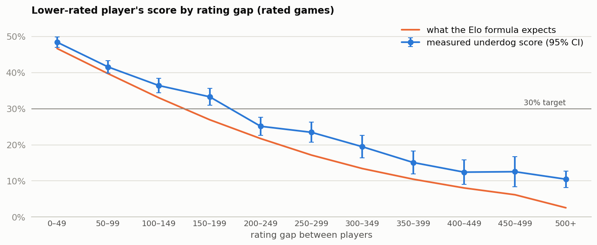

# Lichess matchmaking: where should the rating gap be capped?

Across 15,467 rated games, the lower-rated player's score falls from 48.4% in close matches to 25.1% at a 200–249 point gap. **The recommendation is to test a 200-point cap as a starting point, not to ship it:** it depends on a 30% target I chose, the file doesn't say how games were paired, and it has no queue times. White's first-move edge is small, worth about 18 rating points. This is observational data.



**Read next:** [decision memo](case_study.md) (one page, for a studio head) · [analysis code](src/analysis.py) · [every number](out/results.json)

Decision rules are fixed at the top of [the analysis script](src/analysis.py), and each script stops if its data checks fail. This is independent analysis of public data, and isn't affiliated with any company or game named here.

## How to reproduce

```bash
python3 -m venv .venv && source .venv/bin/activate
```

```bash
pip install -r requirements.txt
```

```bash
tools/get_data.sh
```

```bash
python src/analysis.py
```

## Repo structure

```text
.
├── case_study.md        one-page decision memo
├── src/analysis.py      data checks, analysis, charts
├── src/gamestats.py     statistics helpers and chart style
├── tools/get_data.sh    downloads the source data (not redistributed)
├── out/                 results.json, charts, tables
└── data/                where the download goes
```

## Skills

Fairness analysis · logistic regression · confidence intervals · matchmaking analytics · Python

## More case studies

- [Cookie Cats gate A/B test](https://github.com/rahulkundanjha-blip/cookie-cats-ab-test)
- [Steam player decay after launch](https://github.com/rahulkundanjha-blip/steam-player-decay)
- [Steam library activation](https://github.com/rahulkundanjha-blip/steam-library-activation)
- [League of Legends first 10 minutes](https://github.com/rahulkundanjha-blip/lol-first-10-minutes)

## Contact

KinetiArc
