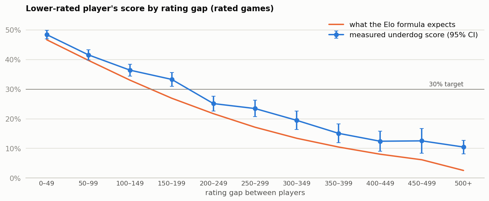

# Lichess matchmaking: where should the rating gap be capped?

*Rahul Jha, KinetiArc. Independent analysis of public data; not affiliated with Lichess.*

## 1. Decision

**Test a 200-point rating cap as a starting point, because above that gap the lower-rated player's score falls clearly below the 30% target, but don't ship it from this data.** The target is my own definition of competitive, the file doesn't show how games were paired, and it has no queue times.

## 2. What we looked at

15,467 rated online games from a public Lichess sample, August 2013 to September 2017, after removing 945 duplicate game IDs from the wider file.
The "score" counts a win as 1, a draw as 0.5 and a loss as 0.

## 3. What happened

| Rating gap | 0–49 | 50–99 | 100–149 | 150–199 | 200–249 | 250–299 | 300–349 |
|---|---|---|---|---|---|---|---|
| Underdog score | 48.4% | 41.6% | 36.4% | 33.3% | 25.1% | 23.5% | 19.5% |

- **The cap:** 200–249 is the first band whose whole range sits below 30% (22.7% to 27.6%).
- **The target drives the answer:** a 35% target also gives 200, but a 25% target gives 300.
- **How much it touches:** 27.7% of rated games have a gap of 200+, so this would be a large change.

## 4. Can we trust it?

- **The biggest question:** a cap only applies to games a matchmaker pairs. Players can also accept open games or challenge each other, and this file doesn't say which is which. These gaps may partly reflect what players chose.
- **What holds:** the pattern doesn't change without 1500-rated players (likely new accounts) and very short games (24.8% at 200–249).
- **One cap may not fit everyone:** at 200–249 the score is 19.6% for players rated 1800–2199 and 27.8% for 1400–1799. The ranges for 1400–1799, under 1400, and the fastest and slowest time controls all still reach above 30%, so these groups don't clear the bar alone.
- **First move:** white scores 51.47% in evenly rated games. The flag triggers narrowly: the range is 50.04% to 52.89%, and it just touches 50% (49.98%) when allowing for repeat players. Across all games, adjusted for rating gap, the edge is clearer and worth about 18 rating points.
- **Ratings understate underdogs:** the score beats the Elo formula's expectation at every gap, such as 25.1% against 21.7% at 200–249. Lichess doesn't use plain Elo, so the formula is only a benchmark.

## 5. What it means for the business

A lower score doesn't mean a worse experience. Median game length barely moves around the cap (57 turns at 150–199, 56 at 200–249), so there's little sign here of games collapsing. Whether players prefer closer games to faster ones is the real question, and neither side of that trade-off is in this data. An 18-point first-move edge doesn't justify a change, as it evens out if a player's colours are balanced across their games.

## 6. Next experiment

Randomise matchmade players between today's pairing and a 200-point cap, and report by rating band and time control. Hypothesis: capped players play more games over 14 days. Metric: games per player. Guardrails: queue time, abandoned searches and underdog score. Sample size needs live variance in games per player.

## 7. Limitations

- Observational, with no pairing method: players with big gaps may differ in other ways.
- No queue times, session lengths or retention, so the cost and the player response to a cap are unmeasured.
- Games from 2013 to 2017, mixing time controls, may not represent today's players.
- 19.4% of games are repeat pairings. Most ranges don't adjust for this, so they're slightly too narrow.
